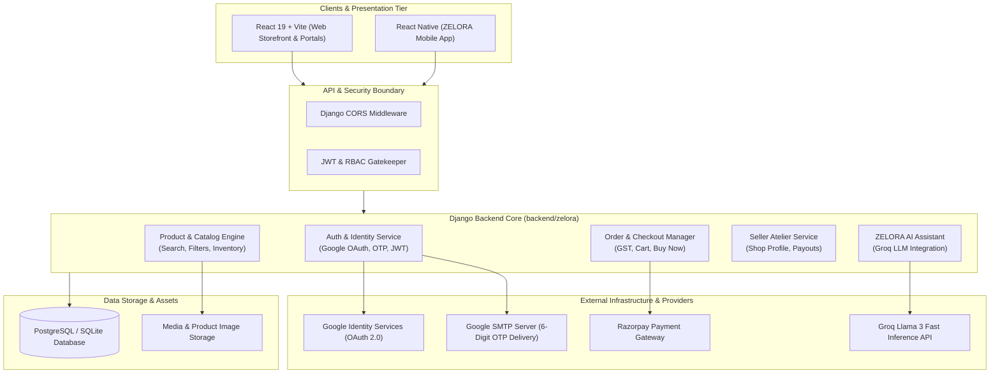
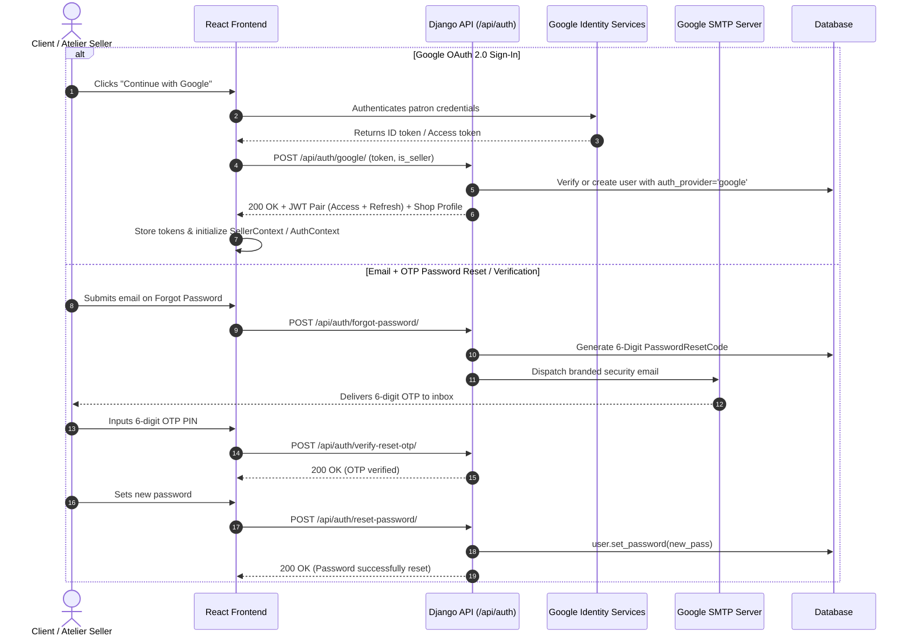
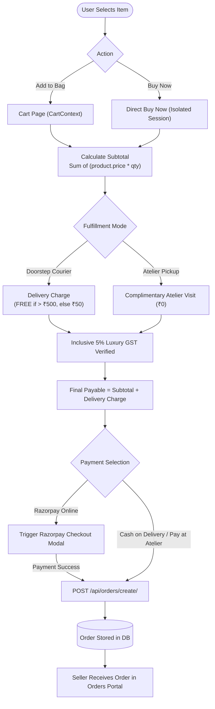
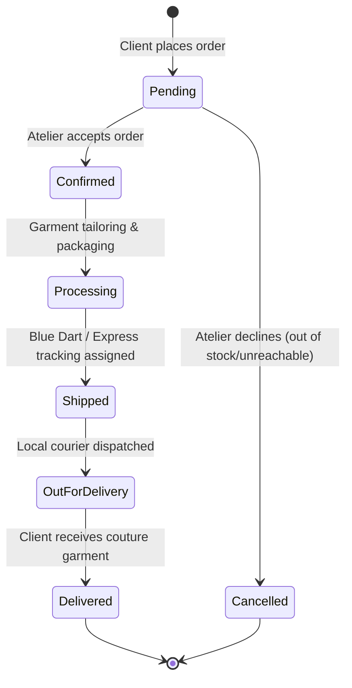
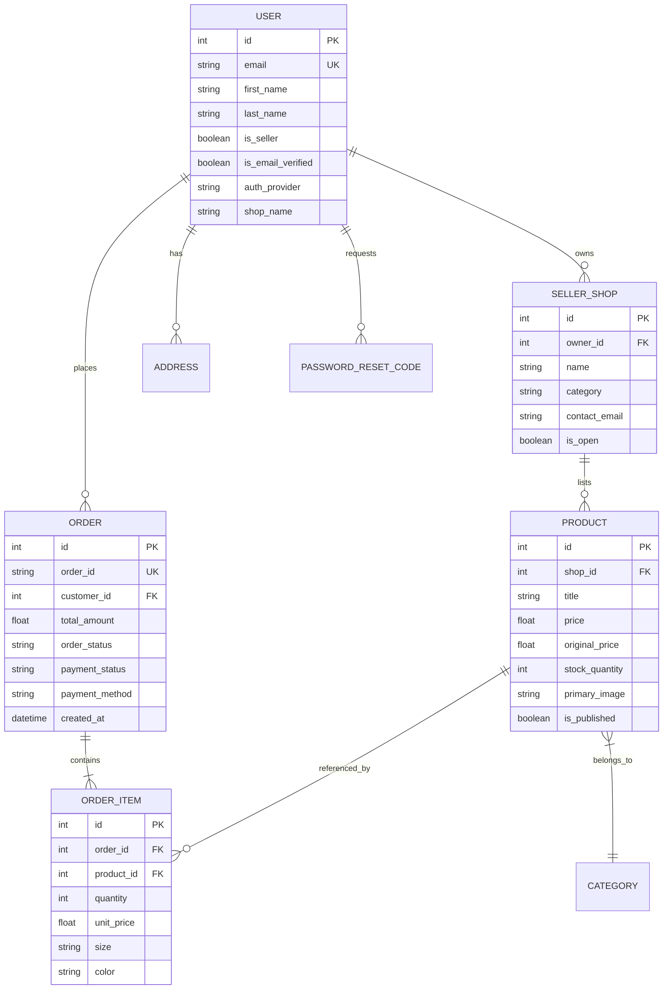
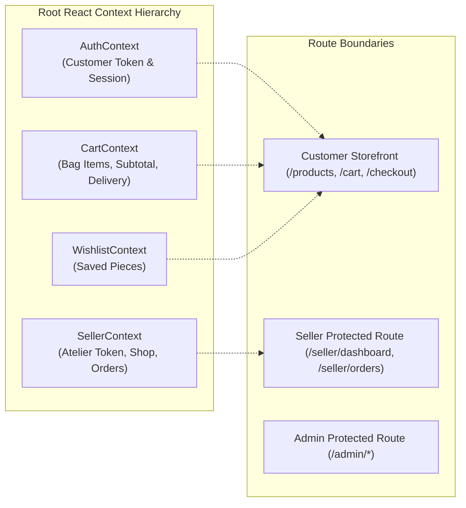

# ZELORA — System Architecture & Workflow Specifications

This document outlines the high-level system architecture, security workflows, data entity relationships, and transaction lifecycles powering the **ZELORA** Luxury Fashion Platform.

---

## 1. High-Level System Architecture

---

## 2. Multi-Role Authentication & Access Control

ZELORA enforces strict role separation across three primary user roles:
- **Client / Customer**: Browses catalog, places orders, manages profile.
- **Boutique Atelier / Seller**: Manages inventory, fulfills bespoke orders, analyzes payouts.
- **Executive Administrator**: Platform moderation, seller verification, commission configuration.

---

## 3. Order Placement & Checkout Lifecycle

---

## 4. Seller Order Fulfillment State Machine

---

## 5. Database Entity-Relationship Model

---

## 6. Frontend State Architecture & Context Isolation

