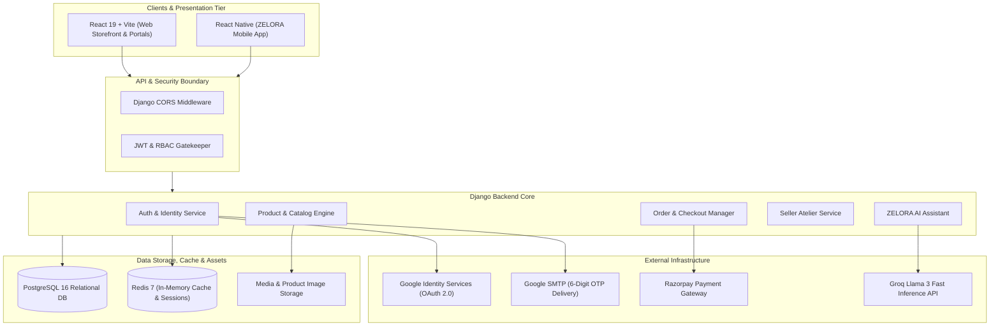

# ZELORA — Luxury Fashion & Haute Couture E-Commerce Platform

A full-stack, multi-role luxury fashion e-commerce web platform engineered with **Django REST Framework** and **React (Vite)**. Built with a minimalist, high-fashion aesthetic (`#000000`, `#ffffff`, `#f7f7f7`, and `#b69a70` couture gold accents) and typography.


> 📖 **Full System Architecture & Workflows:** See [ARCHITECTURE.md](ARCHITECTURE.md) for complete Mermaid diagrams, entity relationship models, and authentication sequences.

---

## 🏛️ System Architecture Diagram



---

## 🐳 Docker & Redis Quick Start

You can run the full multi-container luxury fashion platform (PostgreSQL 16, Redis 7, Django REST Framework, and React 19 / Nginx) using Docker Compose:

### 1. Launch All Containers
```bash
docker compose up --build -d
```

### 2. Verify Container Health
```bash
docker compose ps
```

| Service | Container Name | Port | Description |
|---|---|---|---|
| **Frontend** | `zelora_frontend` | `http://localhost:5173` | React 19 SPA served via Nginx Reverse Proxy |
| **Backend** | `zelora_backend` | `http://localhost:8000` | Django REST Framework API with Gunicorn |
| **Redis** | `zelora_redis` | `localhost:6379` | Redis 7 in-memory cache & session engine |
| **Database** | `zelora_postgres` | `localhost:5432` | PostgreSQL 16 relational database |

### 3. Test Health Endpoint
```bash
curl http://localhost:8000/api/health/
# Returns: {"status": "ok", "service": "ZELORA API", "database": "connected", "redis": "connected"}
```

### 4. Stop All Containers
```bash
docker compose down
```

---

## 🌟 Architecture & Features

### 1. Customer Storefront
- **Landing Page**: Minimalist editorial showcase, hero section, curated categories, and brand features.
- **Product Catalog**: Responsive grid, category & gender filtering, sorting, price range filters, search, and pagination.
- **Product Details**: Image gallery with zoom, size & color variant selector, stock status, reviews, and related items.
- **Shopping Bag & Wishlist**: Persistent cart and wishlist with live badge counters.
- **Seamless Checkout**: Address management, Razorpay payment gateway integration, and cash-on-delivery.
- **Customer Account**: Profile management, order tracking with real-time status timelines, and delivery addresses.

### 2. Authentication & Security
- **Email & Password Authentication**: JWT tokens (access + refresh) with secure token rotation.
- **Live Google OAuth 2.0**: Direct sign-in and registration via Google Identity Services.
- **Two-Factor / Email OTP Verification**: 6-digit OTP delivery via Google SMTP for account activation and password resets.
- **Strict Role-Based Access Control**: Differentiated customer, seller, and administrator sessions.

### 3. Seller Center (Vendor Portal)
- Dedicated merchant onboarding with verification workflows.
- Product inventory management (SKU, pricing, stock levels, variants).
- Order fulfillment lifecycle management (processing, shipping, delivery).
- Real-time merchant analytics and store settings.

### 4. Admin Executive Console
- Comprehensive platform moderation (garment approvals, brand taxonomy, commissions).
- Transaction settlement ledger and Razorpay transaction reconciliation.
- Multi-role administrator privileges and security auditing.

---

## 🛠️ Tech Stack

- **Backend**: Python 3.12, Django 5.x, Django REST Framework, Django CORS Headers, SQLite (or PostgreSQL)
- **Frontend**: React 19, Vite, React Router DOM, Lucide Icons, Canvas Confetti
- **Payments**: Razorpay SDK & Webhooks
- **Mailing**: Google SMTP Backend with HTML template rendering
- **Styling**: Vanilla Modern CSS with CSS Custom Properties and responsive design

---

## 🚀 Quick Start Guide

### Prerequisites
- Python 3.10+
- Node.js 18+ & npm
- Git

---

### Backend Setup

1. Navigate to the backend directory:
   ```bash
   cd backend
   ```

2. Create and activate a virtual environment:
   ```bash
   python -m venv .venv
   # Windows PowerShell
   .venv\Scripts\Activate.ps1
   # macOS/Linux
   source .venv/bin/activate
   ```

3. Install dependencies:
   ```bash
   pip install django djangorestframework django-cors-headers razorpay python-dotenv requests google-auth pillow
   ```

4. Configure environment variables:
   - Copy `.env.example` to `.env`:
     ```bash
     cp .env.example .env
     ```
   - Populate your credentials (`SECRET_KEY`, Google Client ID, Razorpay Keys, Gmail SMTP App Password).

5. Apply migrations and start the server:
   ```bash
   cd zelora
   python manage.py migrate
   python manage.py runserver 8000
   ```

---

### Frontend Setup

1. Navigate to the frontend directory:
   ```bash
   cd frontend-zelora
   ```

2. Install dependencies:
   ```bash
   npm install
   ```

3. Start the Vite development server:
   ```bash
   npm run dev
   ```

4. Build for production:
   ```bash
   npm run build
   ```

---

## 📄 License
This project is proprietary and confidential. All rights reserved by ZELORA.

